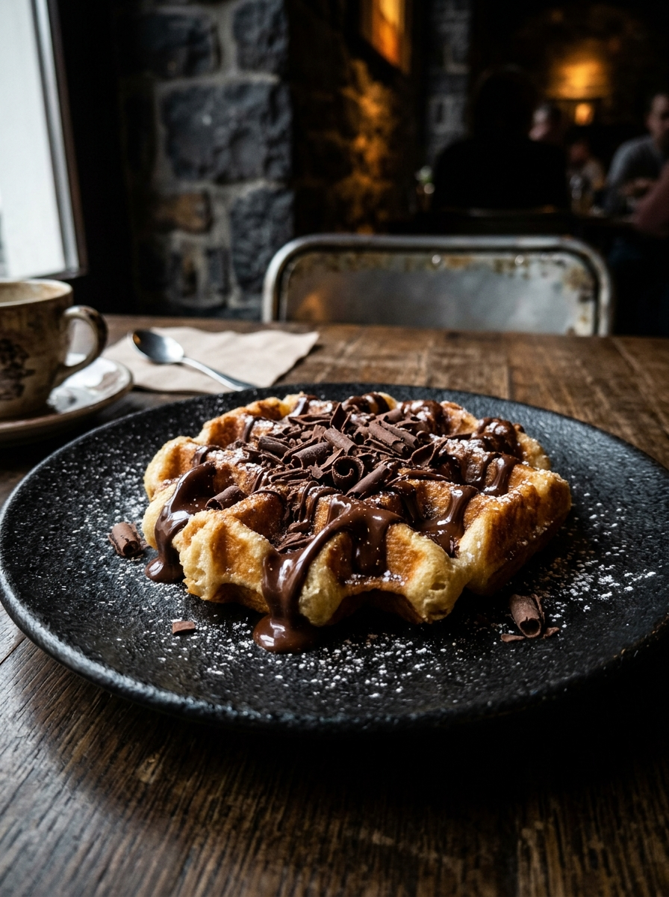
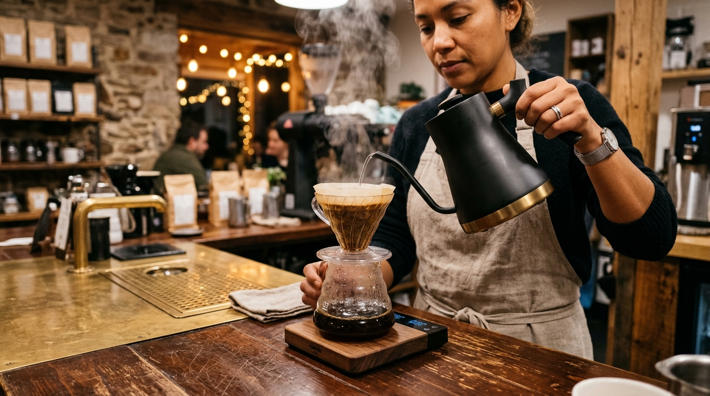

<div align="center">

  

  <br /><br />

  

  <h1 align="center" style="font-family: serif; letter-spacing: 0.3em; font-weight: 300;">
    S O L E R A N
  </h1>

  <p align="center" style="font-size: 1.15rem; color: #C8A96B; letter-spacing: 0.15em;">
    <strong>— A LITTLE EXTRAORDINARY —</strong>
  </p>

  <p align="center" style="color: #B8B0A3; max-width: 620px; line-height: 1.7;">
    <em>An artisan café brand experience curated with quiet luxury, oversized editorial typography, floating culinary photography, and synchronized scroll-driven storytelling.</em>
  </p>

  <br />

  <!-- Luxury Custom Badges -->
  <p align="center">
    <a href="https://nextjs.org"></a>
    <a href="https://www.typescriptlang.org"></a>
    <a href="https://greensock.com/gsap"></a>
    <a href="https://github.com/darkroomengineering/lenis"></a>
    <a href="https://tailwindcss.com"></a>
  </p>

  <br />

  <blockquote>
    <strong>“At Soleran, we believe the best moments are rarely hurried. From the first pour of espresso to the last bite of something sweet, every detail is an invitation to slow down, settle in, and savour the ordinary extraordinary.”</strong>
  </blockquote>

</div>

---

## ⚜️ The Curated Experience

| Scene Index | Scene Title | Palette Mood | Narrative Focus |
| :--- | :--- | :--- | :--- |
| **`00`** | **The Experience** | `#080807` Nocturne & Amber Glow | Slow mornings, quiet luxury café culture, vintage brass machine |
| **`01`** | **The Signature Pour** | `#C8A96B` Sunlit Champagne Gold | Sun-ripened Alphonso mango, silky milk & crystal highball |
| **`02`** | **The Daily Ritual** | `#8E754A` Warm Espresso Bronze | Single-origin pulled espresso, velvet microfoam & rosetta art |
| **`03`** | **The Indulgent Finish**| `#A56C42` Deep Cocoa Velvet | Belgian waffle, dark chocolate drizzle & cocoa shavings |
| **`04`** | **The Philosophy** | `#11100E` Tactile Walnut | Barista V60 pour ritual, single-estate beans, slow extraction |
| **`05`** | **Sanctuary & Visit** | `#181612` Warm Gold Accent | 12 Olive Lane, Bengaluru · 9:00 AM – 10:00 PM |

---

## 🏛️ Haute-Couture Tech Stack

<div align="center">

```
   ┌────────────────────────────────────────────────────────────────────────┐
   │                                                                        │
   │   ❖ CORE ENGINE            ❖ CINEMATIC MOTION     ❖ ART & TYPOGRAPHY   │
   │   ────────────────         ──────────────────     ──────────────────   │
   │   • Next.js 16 (App)       • GSAP 3 Core          • Cormorant Garamond │
   │   • React 19.3             • GSAP ScrollTrigger   • DM Sans Modern     │
   │   • TypeScript 5.8         • Lenis Smooth Scroll  • Tailwind CSS 4     │
   │   • Turbopack Engine       • Ticker Clock Sync    • SVG Film Grain     │
   │                                                                        │
   └────────────────────────────────────────────────────────────────────────┘
```

</div>

### 1. Architectural Foundations
* **Next.js 16 (App Router)**: Server-side rendering, zero-waterfall static prerendering, partial prefetching, and optimal chunk splitting.
* **React 19 & Strict TypeScript**: Complete type safety with custom external store subscriptions (`useSyncExternalStore`) for zero-cascading-render hydration.
* **Turbopack**: Instantaneous HMR development and sub-second builds.

### 2. Motion & Inertia Systems
* **GSAP 3 ScrollTrigger**: Desktop multi-scene container pinning with continuous scrubbing (`scrub: 0.8`), crossfading typography, lighting transforms, and live `01 / 03` counter sync.
* **Lenis Smooth Scroll Engine**: Inertial smooth scrolling clock-synchronized into `gsap.ticker` to eliminate dual animation loops and jitter.
* **Responsive matchMedia**: Desktop pinning gracefully transitions into touch-optimized stacked scenes on mobile viewports.
* **Accessibility**: Full respect for `prefers-reduced-motion: reduce`, downgrading transitions to refined static editorial layouts.

### 3. Editorial Visual Design
* **Curated Palette**: Pure deep black `#080807`, champagne gold `#C8A96B`, espresso bronze `#8E754A`, and warm ivory text `#F5F0E7`.
* **Subtle Atmosphere**: Fine procedural SVG noise grain texture and gentle radial vignette that grounds photography without layout shift.
* **Next.js Image Optimization**: Responsive WebP/AVIF generation with `fetchpriority="high"` on LCP hero assets.

---

## 📸 Editorial Gallery Showcase

<div align="center">

| **01 · The Signature Pour** | **02 · The Daily Ritual** |
|:---:|:---:|
|  |  |
| *Sun-ripened mango, silky milk & velvet finish (₹249)* | *Velvety microfoam & single-origin espresso (₹199)* |

| **03 · The Indulgent Finish** | **04 · The Soleran Philosophy** |
|:---:|:---:|
|  |  |
| *Crisp Belgian waffle with dark chocolate drizzle (₹279)* | *Slow extraction & the patient craft of pour-over* |

</div>

---

## 📁 Repository Blueprint

```
soleran-cinematic/
├── public/
│   ├── images/
│   │   ├── hero-cafe.jpg            # Hero café interior asset
│   │   ├── mango-milkshake.jpg      # Product 01 photography
│   │   ├── cappuccino.jpg           # Product 02 photography
│   │   ├── chocolate-waffle.jpg     # Product 03 photography
│   │   └── story-cafe.jpg           # Story barista ritual asset
│   └── favicon.ico
├── src/
│   ├── app/
│   │   ├── globals.css              # Theme tokens, grain overlay, vignette, & resets
│   │   ├── layout.tsx               # Root layout, Google Fonts, & OpenGraph metadata
│   │   ├── page.tsx                 # Composed single-page application
│   │   └── icon.svg                 # Gold monogram brand icon
│   ├── components/
│   │   ├── Navbar.tsx               # Minimal fixed navigation & mobile drawer
│   │   ├── HeroSection.tsx          # 100svh cinematic hero with GSAP intro
│   │   ├── ProductStory.tsx         # Pinned desktop container & mobile scroll scenes
│   │   ├── ProductScene.tsx         # Reusable asymmetric product layout
│   │   ├── StorySection.tsx         # Brand narrative with scroll reveal
│   │   ├── VisitSection.tsx         # Visit card with direct contact links
│   │   ├── Footer.tsx               # Footer with back-to-top action & copyright
│   │   ├── ScrollProgress.tsx       # Subtle gold progress bar at top of viewport
│   │   └── SmoothScroll.tsx         # Client activator for Lenis smooth scrolling
│   ├── hooks/
│   │   ├── useReducedMotion.ts      # React 19 useSyncExternalStore motion hook
│   │   └── useSmoothScroll.ts       # Lenis + GSAP ScrollTrigger engine sync
│   ├── lib/
│   │   └── products.ts              # Strongly typed product data store
│   └── types/
│       └── index.ts                 # Product and navigation interfaces
├── package.json
├── tsconfig.json
└── README.md
```

---

## 🛠️ Local Development & Scripts

### 1. Installation
```bash
# Clone the repository
git clone https://github.com/suraj-gupta11/cinematic-soleran.git
cd cinematic-soleran

# Install dependencies
npm install
```

### 2. Available Commands

| Command | Action |
| :--- | :--- |
| `npm run dev` | Launch Next.js development server at [http://localhost:3000](http://localhost:3000) |
| `npm run typecheck` | Run strict TypeScript compiler verification without emitting artifacts (`tsc --noEmit`) |
| `npm run lint` | Execute ESLint inspection |
| `npm run build` | Compile optimized production bundle |
| `npm run start` | Serve production build locally |

---

## 🚀 Deployment on Vercel

1. **Push to GitHub**:
   ```bash
   git add .
   git commit -m "feat: complete Soleran Cinematic luxury café website"
   git push -u origin main
   ```

2. **Deploy with Vercel**:
   - Go to [Vercel Dashboard](https://vercel.com) and click **Add New Project**.
   - Import `suraj-gupta11/cinematic-soleran`.
   - Vercel automatically detects **Next.js** framework preset.
   - Click **Deploy** (zero environment variables required).

---

<div align="center">
  <p style="color: #777168; font-size: 0.85rem; letter-spacing: 0.15em;">
    © 2026 SOLERAN ARTISAN CAFÉ · BENGALURU, INDIA · ALL RIGHTS RESERVED
  </p>
  <p style="color: #C8A96B; font-size: 0.8rem;">
    <em>Crafted with Quiet Luxury &amp; Cinematic Motion</em>
  </p>
</div>
